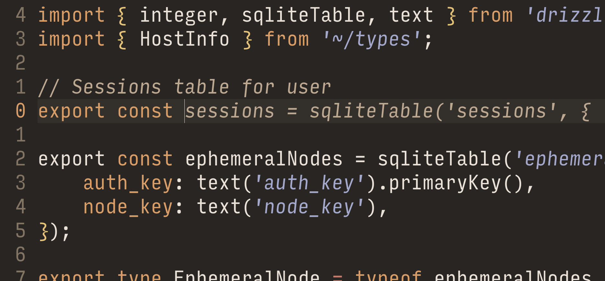
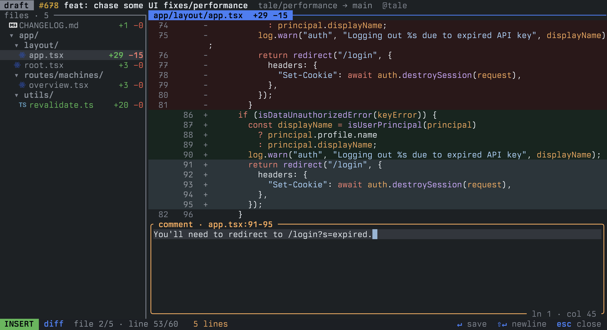

> A year ago, I started writing a post called "The Pragmatic Developer's AI
> Workflow" describing how I was slowly adopting AI into my day-to-day work.
> When I came back to finish it, I realized all of it was obsolete. AI tooling
> has evolved significantly this year, and my old workflow ended up creating
> more problems than it solved.

We're almost three years into "AI will take your job in six months," and I'm
still standing. Our industry has become a battle ground of competence: only the
developers who can do 10x the work of their peers will survive. Navigating this
new landscape has led me to a new way of writing software. Instead of working
through the individual steps myself, I'm now describing the end state and
handing off my work to AI.

## The Imperative Era

I was an early adopter of GitHub Copilot. The autocomplete felt like magic the
first time I used it. It worked as a strong pair programmer, finishing my
sentences and doing a lot of the typing I didn't want to do. I found myself
writing code by describing (in comments) what I wanted the next few lines to do
and Copilot would produce an adequate implementation I could refine.



It worked, but I was still the one driving. I held the solution in my head and
decided every next step. Copilot was the "dumb assistant" that fell apart at the
first sign of needing real reasoning.

In the screenshot above, I typed a one-line comment and Copilot wrote the line
that creates the sessions table. Then it stopped. It knew what a table looked
like, but not what my sessions needed to store. When I nudged it further, it
guessed columns that didn't fit the design. Every useful line still depended on
me knowing what came next.

## From Steps to State

If you've used Nix or Terraform then you already understand the idea behind
this. Define the config you want and the tool works to get there. Declarative
engineering is the same idea with AI: you describe a result (and optionally some
simple implementation details) and an agent writes your change.

```diagram
describe ──▶ agent writes ──▶ review ──▶ ship
   ▲                            │
   └───────── discard ──────────┘
```

It overlaps with "agentic engineering," but that term describes the tooling.
Declarative engineering is the discipline on top, and it asks four things of
you:

- Trust the AI to work on its own without hovering over it.
- Validate through review and tests instead of line by line.
- Throw away work that isn't right instead of patching it.
- Know the system well enough to judge the result yourself.

### Trust It to Work

Everything starts with a detailed description: behavior, constraints, relevant
parts of the codebase, and what "done" looks like. If you feel like writing
step-by-step instructions, there's a good chance you don't understand the end
state well enough yet. For a small fix in my project Headplane, it looks
something like this:

```markdown
Searching or filtering on the machines page shouldn't refetch data. Every
keystroke currently changes the query string and reruns the loader. Do this:

- Dual filtering on the client side and server with a debounce
- No new dependencies or helpers/patterns since this is one off
- Think about pagination & how client only might prevent all results

You'll probably only need to touch the machines overview and use
shouldRevalidate

I'll manually test searching and that renaming a machine doesn't break the
filter. Go
```

There are no steps and I can even be vague about details as the agent can
usually pick them up from the codebase.

After that, I let the agent cook. My days are mostly meetings and code reviews,
so I can't watch over the agent's shoulder even if I wanted to. Since the plan
lives in the description, I don't lose my stride when a product meeting runs
over or a code review requires serious attention.

On a typical day, I kick off two or three tasks in parallel, each in its own
[git worktree](https://git-scm.com/docs/git-worktree). My terminal,
[Rex](https://www.superlogical.com/), notifies me when an agent is done or needs
my attention, and I do a sweep right before each context switch.

### Review and Test

When the agent is done, I review the change the same way I'd review a coworker's
pull request. I read every line and run my own tests. Reading the change as a
unit catches things that line-by-line autocomplete never surfaced, like a
function that's correct but doesn't belong where it was put.

Nothing is perfect on the first pass. If the change is heading in the right
direction, I leave review comments and let the agent fix them. This is where a
strong review tool like [prtui](https://prtui.tale.me/) matters.



### Throw It Away

If it isn't heading in the right direction, I throw it away. That's about a
third of the tasks I start, and it was the hardest habit to pick up.

When I wrote code by hand, throwing away an afternoon of work would hurt, so I'd
attempt to improve a bad approach instead of starting over. Generated code costs
almost nothing, so that sunk cost is gone. A fresh start with a better
description usually beats salvaging a bad implementation.

Once at work, I asked an agent to fix an authentication bug in the main route
handler. Its change was technically correct but didn't feel right. I threw it
away several times before realizing the bug wasn't in the route at all, but in
how the route was being called. The agent's failed attempts were what pointed me
there. Sometimes you _need_ to throw away work to learn something.

### Know the System

You can only validate changes that you'd be able to write yourself. Mitchell
Hashimoto's post on
[vibe-coding a non-trivial Ghostty feature](https://mitchellh.com/writing/non-trivial-vibing)
makes the exact same point: he knew how to do the work himself. Without that
knowledge, a review turns into a half-hearted "LGTM" and you've gone back to
vibe coding.

## Where It Breaks Down

Declarative engineering isn't an answer to all our problems. If I don't know
what the end result looks like, or I'm chasing a bug that I barely understand,
I'm back to working imperatively. It's still my job to figure out _what_ to
build.

When I started building the build system for [Rootbeer](https://rbpkg.com), I
didn't understand build systems well enough to describe the end state. I'd ship
a change, learn something new, and redo it a week later: imperative work with
extra waste. What fixed it was throwing the work away, doing the research, and
starting over once I knew what the solution should look like.

Large diffs are also a trap. When the change is too big to reasonably parse,
it's tempting to skim and approve. Keep tasks small enough to actually read, or
the review stops being honest.

## Who Leads Now

A year ago I was the one guiding and AI was following. Now it's usually the
other way around. I still decide what gets built, and I'm still on the hook for
its quality.

A side effect I didn't expect is how cheap it's become to build my own tools.
Small side projects that weren't worth a weekend now take a single afternoon of
describing and validating. A rough tool that "works" beats the tool that doesn't
get built or someone else's project that doesn't quite fit. More on that soon!
